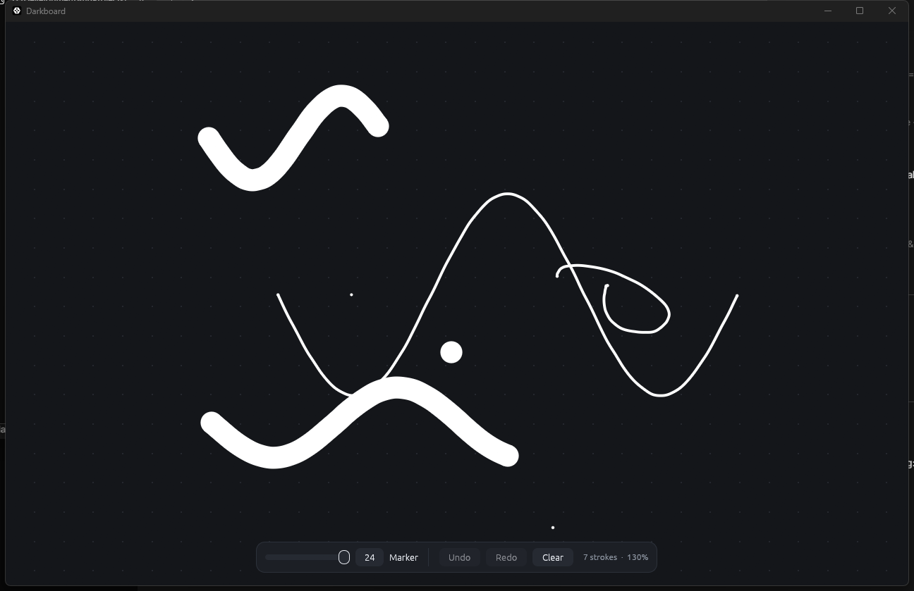

# Darkboard

A native desktop infinite whiteboard in Rust: one dark canvas, one smooth white
marker. Built with [`eframe`/`egui`](https://github.com/emilk/egui) and rendered
with wgpu. No browser, no server, no accounts, no AI.



## Run

```sh
cargo run --release
```

## Controls

| Action | Input |
| --- | --- |
| Draw | Left mouse button |
| Pan | Middle-drag, or hold Space and left-drag |
| Zoom (toward the cursor) | Mouse wheel / trackpad pinch |
| Undo | `Ctrl+Z` |
| Redo | `Ctrl+Shift+Z` or `Ctrl+Y` |
| Marker size | Toolbar slider (1–24 world units) |
| Straight line | Hold Shift while drawing; Shift+click continues from the end of the last stroke |
| Clear | Toolbar button (undoable) |

## Storage

The board is a single versioned JSON file:

- Windows: `%APPDATA%\Darkboard\whiteboard.json`
- otherwise: `$XDG_DATA_HOME/Darkboard/whiteboard.json`, falling back to
  `~/.local/share/Darkboard/whiteboard.json`

Writes are atomic (temp file + rename), so a crash mid-save cannot truncate the
previous board. The file is written about 1.2 s after the last change and once
more on exit. A file that cannot be parsed or comes from a newer format version
is never overwritten: it is renamed to `whiteboard.corrupt-<timestamp>.json`
and a notice is shown in the app.

The saved data is deliberately plain: format version, camera center/zoom,
marker width, and per-stroke width plus `[x, y]` world-space points. It is
ordinary JSON that does not depend on egui types, so the format is readable and
stable.

## How it works

```
src/
  main.rs           window setup
  app.rs            application state, input modes, autosave
  canvas/
    camera.rs       world <-> screen transform, pan, anchored zoom
    stroke.rs       immutable stroke + cached world bounds
    smoothing.rs    denoise + centripetal Catmull-Rom resampling
    render.rs       grid, culling, screen-space decimation
    input.rs        per-frame pointer/wheel events
  document.rs       stroke list + undo/redo history
  persistence.rs    versioned JSON load/save/quarantine
  ui.rs             floating toolbar
  theme.rs          dark graphite palette
```

**Input.** Raw `PointerState` and `Event::MouseWheel`/`Event::Zoom` are read
directly instead of using widget drag state, so every pointer sample reaches the
stroke. Pan and zoom only change the camera; stored world coordinates are never
rewritten by navigation.

**Smoothing.** Raw samples are passed through a centred 3-tap filter (no lag),
then a centripetal Catmull-Rom spline is sampled at roughly 1.2 screen pixels.
The live stroke is re-smoothed into a reused buffer each frame, and the final
points are stored once when the stroke ends. The result is a constant-width,
anti-aliased line with rounded caps (drawn explicitly, since egui's thin-line
path has flat caps).

**Rendering.** Every stroke keeps its axis-aligned world bounds. Each frame,
bounds are projected and tested against the viewport before any geometry is
touched, and visible points closer than one screen pixel are dropped. At the
default zoom this means the per-frame cost depends on what is on screen, not on
the size of the board.

**History.** Undo/redo move stroke data instead of cloning it: an `Add` entry
only needs to pop, and a `Clear` entry owns the strokes it removed. Clearing is
undoable.

**Why no spatial index?** With thousands of strokes, a linear scan of cached
rectangles is a few microseconds per frame, while a tree adds balancing and
update costs on every edit. The linear scan stays until profiling shows it
matters.

## License

Released under the [PolyForm Noncommercial License 1.0.0](LICENSE): free to use,
modify, and share for any noncommercial purpose. Commercial use is not permitted.

## Verification
cargo fmt --check
cargo check
cargo test          # 23 unit tests
cargo clippy --all-targets -- -D warnings
```

Unit tests cover the camera transform (round trip, anchored zoom, clamping,
pan), smoothing (endpoints, degenerate input, spacing), stroke bounds and
sanitisation, undo/redo including clear, and the persistence format (round
trip, missing file, corrupt file, newer version, bad camera).

Manual checks performed on Windows 11:

- drawing with the mouse, including fast strokes, loops and single clicks;
- middle-drag and Space+drag panning, wheel zoom anchored at the cursor;
- undo, redo, clear, and undo of clear;
- closing and reopening the app restores strokes, widths, marker size, camera;
- a deliberately corrupted save file is quarantined and reported, and the app
  starts on an empty board;
- a generated board of 5,000 strokes (100 points each, 8.5 MB of JSON) loads and
  pans smoothly;
- a stroke drawn immediately before closing the window is saved on exit.

Frame intervals measured with repaint forced every frame (release build, so not
vsync-capped), on a 1920×1080 display:

| Board | View | Frame interval |
| --- | --- | --- |
| 5,000 strokes × 100 points | 100% zoom (~200 strokes on screen) | 4.2 ms |
| 5,000 strokes × 100 points | 10% zoom (all 5,000 on screen) | 6.3 ms |

Saving that board takes about 29 ms and loading it about 33 ms in a release
build, so the debounced autosave is a single short hitch rather than a stall.
